<!-- cover:start -->
Laporan Program: Secure Multiplayer Game Simulator
Mata Kuliah: Kriptografi (C)
Dosen Pengampu: Annisaa Sri Indrawanti, S.Kom., M.Kom.
Kelompok 4
Nama Anggota Kelompok:
1. Ahmad Wildan Fawwaz - 5027241001
2. Dimas Satya Andhika - 5027241032
3. Daniswara Fausta Novanto - 5027241050
Program Studi: Teknologi Informasi
Departemen: Teknologi Informasi
Fakultas: FTEIC (Fakultas Teknologi Elektron dan Informatika Cerdas)
Institusi: Institut Teknologi Sepuluh Nopember
Tahun: 2026
<!-- cover:end -->

<!-- pagebreak -->

# BAB I — PENDAHULUAN

## 1.1 Latar Belakang

Permainan daring multipemain membutuhkan pertukaran data yang cepat dan dapat dipercaya. Pada arsitektur server otoritatif, pemain tidak mengirim posisi akhir begitu saja, tetapi mengirim niat atau aksi yang kemudian divalidasi dan dieksekusi oleh server. Contoh data yang umum dikirim adalah kode aksi (serang, bertahan, heal) dan skor pemain. Data tersebut melewati jaringan publik yang tidak dapat dianggap aman: kabel, Wi-Fi, router, dan penyedia layanan jaringan dapat menjadi titik penyadapan.

Dalam studi kasus ini, seorang pemain mengirim kode aksi atau skor kepada server game. Di tengah jaringan terdapat Eve, penyadap pasif yang dapat menyalin paket, dan pada skenario lanjutan dapat mengubah paket. Tanpa perlindungan, Eve dapat membaca aksi pemain atau memalsukan skor. Karena itu diperlukan dua kemampuan kriptografi: menyepakati kunci rahasia melalui jaringan terbuka dan mengenkripsi pesan dengan kunci publik server.

Diffie-Hellman (DH) menyediakan mekanisme pertukaran kunci. Pemain dan server masing-masing memilih eksponen rahasia dan bertukar nilai publik. Kunci sesi K dihitung dari nilai publik lawan dan eksponen rahasia sendiri, sehingga K tidak pernah dikirim. ElGamal menyediakan enkripsi kunci publik. Pemain mengenkripsi pesan dengan kunci publik server, dan hanya server yang memiliki kunci privat dapat membukanya.

Program ini menggabungkan keduanya dalam satu alur yang dapat dijalankan tahap demi tahap. Sebelum dienkripsi, pesan disamarkan dengan kunci sesi: m' = (m + K) mod p. Server harus mendekripsi ElGamal terlebih dahulu, lalu melepas topeng dengan K. Dengan demikian, keberhasilan pemulihan pesan bergantung pada dua rahasia yang berbeda: kunci privat ElGamal milik server (x) dan kunci sesi hasil DH (K).

## 1.2 Rumusan Masalah

Berdasarkan latar belakang tersebut, rumusan masalah pada proyek ini adalah:

1. Bagaimana mengimplementasikan eksponensiasi modular, invers modular, Diffie-Hellman, dan ElGamal dari nol tanpa pustaka kriptografi siap pakai?
2. Bagaimana menampilkan setiap tahap perhitungan, termasuk nilai antara dan substitusi angka, agar hasilnya dapat diverifikasi secara manual?
3. Bagaimana merancang komunikasi client-server yang memisahkan kunci publik, kunci privat, ciphertext, dan aturan permainan?
4. Bagaimana menerapkan ElGamal pada data aksi game sehingga server dapat memvalidasi aksi dan memperbarui HP monster tanpa mempercayai damage dari client?
5. Bagaimana membuktikan kebenaran implementasi melalui pengujian otomatis dan pengujian antarmuka?
6. Bagaimana menjelaskan batas keamanan, integritas, autentikasi, dan penggunaan parameter kecil secara jujur?

## 1.3 Tujuan

Tujuan pembuatan program dan laporan ini adalah:

1. Mengimplementasikan aritmetika modular, pembangkitan prima, Diffie-Hellman, dan ElGamal dari nol menggunakan Python standard library.
2. Menampilkan setiap tahap algoritma, mulai dari parameter publik sampai skenario serangan, dengan angka nyata yang dapat diverifikasi.
3. Membangun antarmuka web satu halaman yang memperlihatkan peran pemain, jaringan/Eve, dan server secara berdampingan.
4. Menyediakan Mode Demo 16 bit untuk verifikasi manual dan Mode Aman 128 bit untuk menunjukkan pengaruh ukuran parameter.
5. Menyediakan Arena pertarungan pemain melawan monster dengan parameter p=23, kode aksi 1/2/3, pemetaan damage otoritatif server, dan HP yang benar-benar diperbarui.
6. Menyediakan demonstrasi manual p=23 yang menampilkan A=8, B=19, K=2, y=8, c1=10, c2=3, s=6, s⁻¹=4, dan m′=12.
7. Menganalisis keamanan, keterbatasan, dan skenario serangan terhadap rancangan tersebut.
8. Menyediakan pengujian otomatis yang memeriksa kebenaran fungsi matematika, pertukaran kunci, enkripsi-dekripsi, aturan arena, endpoint HTTP, dan skenario tamper.

## 1.4 Manfaat

Manfaat teoretis proyek ini adalah memberikan contoh konkret bagaimana aritmetika modular, logaritma diskret, Diffie-Hellman, dan ElGamal saling berhubungan. Mahasiswa dapat membandingkan hasil program dengan perhitungan manual dan melihat mengapa kebenaran matematis tidak otomatis berarti keamanan implementasi.

Manfaat praktisnya adalah tersedianya aplikasi demonstrasi yang dapat dijalankan secara lokal, dipakai di kelas, dan dimodifikasi untuk eksperimen. Proyek ini juga menunjukkan pola server otoritatif: client mengirim niat atau aksi, sedangkan server memegang aturan permainan, kunci privat, dan kebenaran state.

## 1.5 Batasan dan Lingkup

Program ini memiliki batasan sebagai berikut:

- Logika kriptografi ditulis sendiri. Tidak ada pustaka kriptografi, pustaka matematika kripto, atau pemanggilan pow(a, b, m) tiga argumen pada kode utama.
- Backend hanya memakai Python standard library, yaitu http.server, json, os, threading, dan modul standar lain yang tidak menyediakan primitif kriptografi siap pakai.
- Frontend hanya memakai HTML, CSS, dan JavaScript murni. Tidak ada CDN, framework, atau pustaka JavaScript eksternal. Font disimpan lokal agar aplikasi dapat berjalan offline.
- Frontend tidak melakukan perhitungan kriptografi. Seluruh bilangan besar dikirim sebagai string agar presisi JavaScript tidak hilang.
- State sesi disimpan di memori server. Aplikasi ditujukan untuk demonstrasi satu sesi, bukan layanan produksi.
- Mode Demo memakai safe prime sekitar 16 bit agar angka mudah dibaca. Mode Aman memakai safe prime sekitar 128 bit. Ukuran 128 bit belum memenuhi standar produksi untuk DH atau ElGamal.
- Program ini bersifat edukatif. Ia tidak menggantikan TLS, tanda tangan digital, atau mekanisme autentikasi yang layak produksi.

# BAB II — LANDASAN TEORI

## 2.1 Aritmetika Modular

Aritmetika modular bekerja pada sisa pembagian terhadap modulus m. Dua bilangan a dan b kongruen modulo m jika (a - b) habis dibagi m, ditulis a ≡ b (mod m). Dalam program, hasil selalu dinormalisasi ke rentang 0 sampai m-1 dengan operasi modulo.

Operasi dasar yang dibutuhkan adalah:

- FPB(a, b) dengan algoritma Euclidean: selama b ≠ 0, ganti (a, b) dengan (b, a mod b).
- Invers modular a^-1 mod m, yaitu bilangan x sehingga a·x ≡ 1 (mod m). Invers ada jika dan hanya jika FPB(a, m) = 1. Invers dihitung dengan extended Euclidean.
- Eksponensiasi modular a^b mod m dengan square-and-multiply. Algoritma membaca bit eksponen dari yang paling rendah, mengkuadratkan faktor setiap langkah, dan mengalikan hasil ketika bit bernilai 1. Kompleksitasnya O(log b) perkalian modular.

Square-and-multiply penting karena eksponen pada DH dan ElGamal dapat bernilai puluhan ribu bahkan 128 bit. Menghitung pangkat penuh terlebih dahulu akan menghasilkan bilangan yang sangat besar dan tidak efisien.

## 2.2 Logaritma Diskret

Diberikan bilangan prima p, generator g, dan nilai h = g^x mod p. Masalah logaritma diskret (DLP) adalah menemukan x dari h, g, dan p. Untuk p yang besar dan dipilih dengan benar, tidak ada algoritma klasik yang efisien. Keamanan Diffie-Hellman dan ElGamal bertumpu pada kesulitan masalah ini.

Pada Mode Demo 16 bit, p hanya sekitar 46.000, sehingga pencarian x dapat dilakukan dengan brute force dalam waktu singkat. Mode ini memang dirancang untuk pembelajaran, bukan untuk keamanan. Pada Mode Aman 128 bit, ruang pencarian jauh lebih besar, tetapi modulus 128 bit masih terlalu kecil untuk aplikasi nyata.

## 2.3 Diffie-Hellman

Diffie-Hellman memungkinkan dua pihak menyepakati kunci sesi melalui kanal terbuka. Parameter publiknya adalah bilangan prima p dan generator g. Protokolnya:

1. Pemain memilih a rahasia pada 2 ≤ a ≤ p-2, lalu menghitung A = g^a mod p dan mengirim A.
2. Server memilih b rahasia pada 2 ≤ b ≤ p-2, lalu menghitung B = g^b mod p dan mengirim B.
3. Pemain menghitung K_pemain = B^a mod p.
4. Server menghitung K_server = A^b mod p.

Kedua nilai sama karena:

K_pemain = B^a = (g^b)^a = g^(ab) = (g^a)^b = A^b = K_server (mod p).

Eve yang melihat A dan B tidak dapat menghitung K tanpa menemukan a atau b. Namun, DH polos tidak mengautentikasi pihak yang bertukar kunci. Penyerang aktif dapat melakukan man-in-the-middle dengan membangun dua sesi DH terpisah, satu dengan pemain dan satu dengan server.

## 2.4 Safe Prime dan Generator

Safe prime adalah bilangan prima p yang dapat ditulis sebagai p = 2q + 1 dengan q juga prima. Bentuk ini membuat grup perkalian modulo p memiliki subgrup besar berorder prima q. Generator g yang dipilih harus memenuhi:

- g^2 mod p ≠ 1, sehingga order g bukan 1 atau 2.
- g^q mod p ≠ 1, sehingga order g bukan q.

Jika kedua syarat terpenuhi, order g adalah 2q = p-1 dan g membangkitkan seluruh grup. Pemeriksaan ini penting agar kunci tidak terperangkap pada subgrup kecil yang dapat diserang dengan Pohlig-Hellman.

## 2.5 ElGamal

ElGamal adalah skema enkripsi kunci publik yang juga berbasis logaritma diskret. Misalkan p prima dan g generator. Server memilih kunci privat x pada 2 ≤ x ≤ p-2 dan menghitung kunci publik y = g^x mod p. Kunci publik (p, g, y) boleh diketahui semua pihak; x tetap rahasia.

Untuk mengenkripsi pesan m dengan 0 ≤ m < p, pemain memilih nonce k acak dengan syarat FPB(k, p-1) = 1, lalu menghitung:

c1 = g^k mod p

c2 = m · y^k mod p.

Pasangan (c1, c2) dikirim ke server. Server menghitung:

s = c1^x mod p

m = c2 · s^-1 mod p.

Kebenaran dekripsi dapat dibuktikan sebagai berikut:

c2 · s^-1 = (m · y^k) · (g^(kx))^-1 = m · g^(xk) · g^(-xk) = m (mod p).

Karena k dipilih acak dan berbeda untuk setiap pesan, ElGamal bersifat probabilistik: pesan yang sama menghasilkan ciphertext yang berbeda. Syarat FPB(k, p-1) = 1 memastikan s memiliki invers modular.

## 2.6 Penggabungan Diffie-Hellman dan ElGamal

Program ini memiliki dua jalur demonstrasi yang sengaja dipisahkan. Pada **laboratorium tahapan**, ElGamal tidak langsung mengenkripsi m; pesan disamarkan terlebih dahulu dengan kunci sesi K hasil DH. Pada **Arena pertarungan**, ElGamal memakai kunci publik server secara langsung dan K tidak dipakai sebagai kunci privat ElGamal. Perbedaan ini penting agar pembaca tidak menyimpulkan bahwa DH otomatis menjadi kunci ElGamal.

Untuk laboratorium tahapan, pesan disamarkan terlebih dahulu dengan kunci sesi K hasil DH:

m' = (m + K) mod p.

Setelah itu, m' dienkripsi dengan ElGamal:

c1 = g^k mod p

c2 = m' · y^k mod p.

Server mendekripsi ElGamal untuk memperoleh m', lalu melepas topeng:

m = (m' - K) mod p.

Secara operasional, kedua tahap saling bergantung. Jika x salah, server tidak dapat memperoleh m' yang benar. Jika K salah, server memperoleh m' yang benar tetapi m akhirnya salah. Dengan demikian, server membutuhkan dua rahasia yang berbeda: x milik ElGamal dan K hasil DH.

Perlu dicatat bahwa secara keamanan, ElGamal saja sudah menyembunyikan m dari Eve. Lapisan m' = (m + K) mod p tidak menggantikan ElGamal dan tidak menambahkan autentikasi. Manfaatnya dalam program ini adalah mengikat pesan ke sesi DH, menunjukkan ketergantungan dua skema, dan memberi lapisan pertahanan berlapis yang bersifat edukatif. Pada sistem produksi, Confidentiality tetap harus disertai integritas dan autentikasi.

## 2.7 Sifat Malleable ElGamal

ElGamal polos tidak memiliki tag integritas. Jika Eve mengubah c2 menjadi c2' = c2 + δ mod p, server akan mendekripsi menjadi:

m'_t = c2' · s^-1 = (c2 + δ) · s^-1 = m' + δ·s^-1 (mod p).

Setelah pelepasan topeng, m_t = m + δ·s^-1 (mod p). Plaintext berubah tanpa error. Karena Eve tidak mengetahui K atau s^-1, ia tidak dapat memilih perubahan yang tepat untuk menghasilkan pesan tertentu, tetapi ia tetap dapat merusak atau mengacak pesan. Inilah sifat malleable yang dibahas pada Tahap 7.

# BAB III — ANALISIS DAN PERANCANGAN

## 3.1 Skenario Game Online

Aplikasi memiliki dua jalur studi kasus yang dapat dipilih pengguna:

1. **Laboratorium tahapan 0–7**: pemain mengirim kode aksi atau skor; pesan disamarkan dengan K hasil DH lalu dienkripsi ElGamal. Jalur ini menekankan keterkaitan DH dan ElGamal.
2. **Arena pertarungan p=23**: pemain memilih Serang, Skill, atau Bertahan; kode aksi dienkripsi langsung dengan ElGamal memakai kunci publik server. Server memetakan kode ke damage dan memperbarui HP monster. Jalur ini menekankan aturan game otoritatif dan contoh perhitungan manual.

Skenario umumnya adalah pertukaran data antara satu pemain dan satu server game:

- Pemain memilih kode aksi 1 = Serang, 2 = Skill, atau 3 = Bertahan, atau memasukkan skor non-negatif pada laboratorium.
- Server harus menerima aksi atau skor yang benar dan menampilkannya; pada Arena, server juga memperbarui HP monster.
- Jaringan tidak aman. Eve dapat membaca semua paket dan, pada skenario serangan, mengubah ciphertext.
- Parameter p, g, dan kunci publik y bersifat publik.
- Rahasia pemain a dan k, rahasia server b dan x, serta kunci sesi K tidak boleh diketahui Eve.
- Pesan m juga harus tetap rahasia.

## 3.2 Aktor dan Data

| Aktor | Peran | Data yang dipegang |
|---|---|---|
| Pemain | Klien game yang mengirim aksi/skor | a, A, K, m, m', k, c1, c2 |
| Server | Otoritas game yang memvalidasi dan mendekripsi | x, y, b, B, K, c1, c2, m', m |
| Monster / state game | State otoritatif di server | HP monster, aturan damage, riwayat aksi |
| Eve | Penyadap pasif/aktif di jaringan | p, q, g, y, A, B, c1, c2, dan c2 yang diubah |
| Jaringan | Kanal tidak aman | Semua paket yang dikirim, tanpa jaminan integritas |

Data publik sengaja dipisahkan dari data rahasia. Pada antarmuka, data publik ditandai biru dan data rahasia ditandai oranye. Eve hanya menerima daftar data publik; nilai a, b, x, k, K, m, dan m' tidak dimasukkan ke endpoint Eve.

## 3.3 Diagram Alur

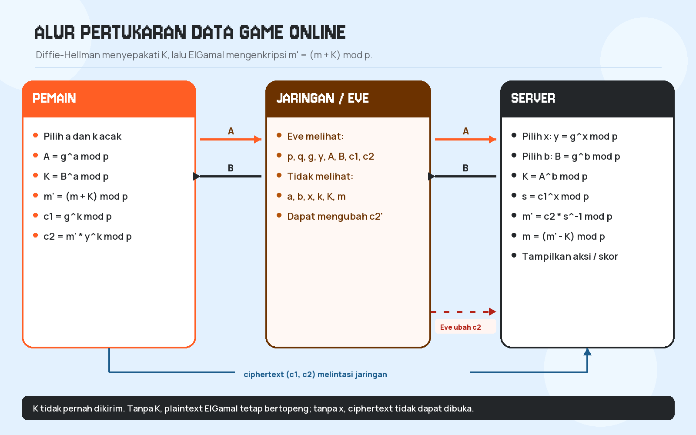

Alur pada diagram di atas dapat dibaca sebagai berikut:

1. Server membuat parameter publik p, q, g dan kunci ElGamal y.
2. Pemain dan server menjalankan DH: A dan B bertukar, lalu K dihitung di kedua sisi.
3. Pemain menyamarkan m menjadi m' dengan K, lalu mengenkripsi m' dengan ElGamal.
4. Ciphertext (c1, c2) melewati jaringan dan dapat disalin Eve.
5. Server memakai x untuk membuka ElGamal, lalu K untuk melepas topeng.
6. Eve dapat mengubah c2; server mendekripsi nilai yang berubah dan memvalidasinya.

## 3.4 Pembagian Peran Diffie-Hellman dan ElGamal

| Aspek | Diffie-Hellman | ElGamal |
|---|---|---|
| Tujuan utama | Menyepakati kunci sesi K | Mengenkripsi pesan m' dengan kunci publik server |
| Rahasia | a (pemain), b (server) | x (server), k (pemain) |
| Nilai publik | p, q, g, A, B | p, q, g, y, c1, c2 |
| Output | K = g^(ab) mod p | Pasangan ciphertext (c1, c2) |
| Ketergantungan | K dipakai untuk membentuk m' | m' adalah input enkripsi |
| Serangan utama | MITM karena tidak ada autentikasi | Malleability karena tidak ada integritas |

Pembagian ini membuat dua jenis rahasia tidak tercampur. x hanya ada di server dan tidak pernah dikirim. K dihitung di kedua sisi dan tidak pernah dikirim. Pesan m hanya diketahui pemain dan server setelah dekripsi.

## 3.5 Ketergantungan Tahap 2 sampai 5

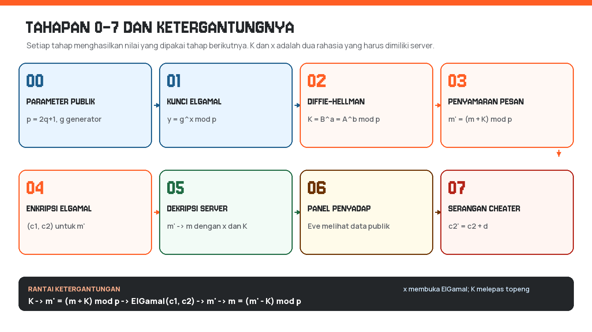

Rantai ketergantungannya adalah:

K → m' = (m + K) mod p → ElGamal(c1, c2) → m' → m = (m' - K) mod p.

Jika server salah menghitung K, hasil akhir m akan bergeser. Jika server salah menggunakan x, dekripsi ElGamal menghasilkan m' yang salah. Karena itu, uji coba pada program selalu memeriksa dua hal: K pemain = K server pada Tahap 2d, dan m hasil dekripsi = m asli pada Tahap 5b.

## 3.6 Rancangan Antarmuka

Antarmuka berupa satu halaman dengan bagian utama:

- Header berisi nama proyek dan identitas mata kuliah/kelompok.
- Panel PEMAIN, JARINGAN/EVE, dan SERVER ditampilkan berdampingan pada layar lebar.
- Panel pemain dan server menampilkan data publik, data rahasia, serta data yang dikirim/diterima.
- Panel tengah menampilkan paket yang lewat, daftar data yang bisa/tidak bisa dilihat Eve, dan tombol Cheater.
- Control bar berisi pilihan Mode Demo/Mode Aman, jenis data, nilai aksi/skor, tombol Langkah Berikutnya, Jalankan Semua, dan Reset.
- Kartu tahap 0 sampai 7 menampilkan nama tahap, rumus, substitusi angka, hasil, dan catatan.
- Log eksekusi menampilkan urutan kejadian.
- Tema menggunakan warna oranye untuk aksi/rahasia, biru untuk data publik, dan merah untuk serangan.

## 3.7 Rancangan Backend dan API

Server menyimpan satu state sesi di memori. State dilindungi lock agar permintaan tidak saling menimpa. Endpoint utama adalah:

| Metode | Endpoint | Fungsi |
|---|---|---|
| POST | /api/setup | Membuat p, q, g dan mereset sesi |
| POST | /api/elgamal/key | Membuat kunci ElGamal x, y |
| POST | /api/dh/start | Memilih a dan menghitung A |
| POST | /api/dh/finish | Memilih b, menghitung B, K pemain, K server, dan verifikasi |
| POST | /api/send | Memvalidasi m dan menghitung m' = (m + K) mod p |
| POST | /api/encrypt | Memilih k dan menghitung c1, c2 |
| POST | /api/decrypt | Menghitung s, s^-1, m', dan m |
| GET | /api/eve | Menampilkan data publik yang terlihat Eve |
| POST | /api/tamper | Mengubah c2 dan mendekripsi hasilnya |
| POST | /api/reset | Menghapus state sesi laboratorium |
| GET | /api/state | Mengambil state sesi saat ini |
| GET | /api/health | Pemeriksaan kesehatan server |
| GET | /api/arena/state | Mengambil state arena, HP, kunci, log, dan validasi |
| POST | /api/arena/encrypt | Sisi client: mengenkripsi kode aksi dengan kunci publik y=8 |
| POST | /api/arena/submit | Sisi server: mendekripsi, memvalidasi, dan memperbarui HP |
| POST | /api/arena/reset | Mengembalikan HP dan turn arena ke kondisi awal |
| GET | /api/textbook | Mengembalikan contoh perhitungan p=23 yang sudah dihitung Python |
| POST | /api/textbook/elgamal | Menghitung ulang contoh ElGamal untuk m dan k tertentu |

Setiap respons tahap memuat objek stage berisi blok rumus, substitusi, hasil, ringkasan, catatan, dan nilai mentah. Nilai kripto dikirim sebagai string. Frontend tidak melakukan operasi aritmetika pada nilai tersebut.

## 3.8 Pemetaan Tahap 0–7

| Tahap | Nama | Proses | Data kunci |
|---|---|---|---|
| 0 | Parameter publik | Membangkitkan safe prime dan generator | p, q, g |
| 1 | Kunci ElGamal | Memilih x dan menghitung y | x, y |
| 2 | Diffie-Hellman | A, B, K, dan verifikasi | a, A, b, B, K |
| 3 | Penyamaran pesan | m' = (m + K) mod p | m, m' |
| 4 | Enkripsi ElGamal | c1 = g^k, c2 = m'·y^k | k, c1, c2 |
| 5 | Dekripsi server | s, s^-1, m', m | x, K, s, s^-1 |
| 6 | Panel Eve | Menampilkan data publik vs rahasia | p, q, g, y, A, B, c1, c2 |
| 7 | Serangan cheater | Mengubah c2 dan mendeteksi hasil | c2', m'_t, m_t |

## 3.9 Kebutuhan Fungsional dan Nonfungsional

Kebutuhan fungsional utama:

| ID | Kebutuhan | Bukti implementasi |
|---|---|---|
| FR-01 | Menyediakan parameter publik dan kunci ElGamal | Tahap 0 dan 1 |
| FR-02 | Menjalankan Diffie-Hellman dua sisi dan memverifikasi K | Tahap 2 |
| FR-03 | Menampilkan rumus, substitusi, dan hasil antara | Kartu tahap dan panel manual p=23 |
| FR-04 | Mengenkripsi kode aksi dengan ElGamal | Endpoint /api/arena/encrypt dan /api/encrypt |
| FR-05 | Mendekripsi ciphertext dan memvalidasi kode aksi | Endpoint /api/arena/submit dan /api/decrypt |
| FR-06 | Memperbarui HP monster dengan damage dari server | game_engine.py dan Arena |
| FR-07 | Menolak ciphertext tidak valid tanpa mengubah HP | Validasi c1/c2 dan transaction rejected |
| FR-08 | Menampilkan log komunikasi dan riwayat aksi | Panel log dan tabel riwayat |
| FR-09 | Menyediakan pengujian otomatis | tests/test_crypto.py dan tests/test_arena.py |

Kebutuhan nonfungsional:

| ID | Kebutuhan | Pemenuhan |
|---|---|---|
| NFR-01 | Berjalan lokal tanpa dependensi pihak ketiga | Python standard library dan file statis lokal |
| NFR-02 | Tidak memakai pustaka kriptografi siap pakai | Hanya mathutil.py, diffie_hellman.py, elgamal.py |
| NFR-03 | Antarmuka responsif dan dapat dibaca | Tema Obscura, layout grid, media query |
| NFR-04 | Hasil dapat diaudit | Nilai antara, trace square-and-multiply, log |
| NFR-05 | Tidak mengeksekusi input sebagai kode | Tidak ada eval() atau exec() pada input pengguna |
| NFR-06 | Dapat diuji ulang | Perintah unittest dan reference_demo.py |

## 3.10 Format Pesan Aksi Game

Arena memakai satu bilangan sebagai plaintext. Pemetaan dilakukan di server agar client tidak dapat memilih damage secara bebas.

| Kode m | Aksi | Damage ke monster | Serangan balik monster | Efek lain |
|---:|---|---:|---:|---|
| 1 | Serang | 25 | 10 | — |
| 2 | Gunakan Skill | 30 | 6 | — |
| 3 | Bertahan | 0 | 0 | Pulihkan 5 HP pemain |

Pesan yang dienkripsi adalah kode aksi m ∈ {1, 2, 3}. Karena m < p = 23, pesan berada di ruang pesan ElGamal. Format paket yang dikirim client ke server adalah:

```json
{
  "ciphertext": { "c1": 10, "c2": 6 },
  "action": "attack",
  "damage": 999
}
```

Server hanya memakai ciphertext untuk memperoleh kode aksi. Field `action` dan `damage` hanya dicatat untuk audit; nilai damage yang berlaku selalu berasal dari tabel di atas. Untuk mode deterministik dipakai k=3; untuk mode acak, server memilih k dari 2..21 yang koprima dengan p-1=22.

## 3.11 Diagram Urutan Diffie-Hellman dan ElGamal

Urutan Diffie-Hellman pada laboratorium tahapan:

```text
Pemain                         Server
  |                              |
  |-- p, q, g (publik) --------->|
  |                              |
  |-- A = g^a mod p ------------>|
  |<-- B = g^b mod p ------------|
  |                              |
  | K_pemain = B^a mod p         | K_server = A^b mod p
  |                              |
  |        K_pemain == K_server ?|
  |<-- verifikasi K -------------|
```

Urutan ElGamal pada Arena:

```text
Pemain (client)                Server (game authority)
  |                              |
  | kunci publik y=8             | kunci privat x=6
  |                              |
  | pilih kode aksi m            |
  | pilih k (3 atau acak)        |
  | c1 = g^k mod p               |
  | c2 = m * y^k mod p           |
  |                              |
  |-- C = (c1, c2) ------------->|
  |                              | s = c1^x mod p
  |                              | m' = c2 * s^-1 mod p
  |                              | validasi m' ∈ {1,2,3}
  |                              | damage = tabel_aksi[m']
  |                              | HP_monster = max(0, HP - damage)
  |<-- hasil, HP, dan log -------|
```

# BAB IV — IMPLEMENTASI

## 4.1 Struktur Folder

```text
Secure-Multiplayer-Game-Simulation/
  source_code/
    mathutil.py
    diffie_hellman.py
    elgamal.py
    game_engine.py
    server.py
    reference_demo.py
    static/
      index.html
      css/style.css
      js/app.js
      js/arena.js
      js/pixels.js
      fonts/
    tests/
      test_crypto.py
      test_arena.py
  docs/
    build_report.py
    build_pdf.py
    Perhitungan_Manual.md
    diagram-alur.png
    diagram-tahapan.png
    screenshots/
  README.md
  README.txt
  requirements.txt
  .gitignore
  Laporan_Kelompok_4.md
  Laporan_Kelompok_4.docx
  Laporan_Kelompok_4.pdf
```

## 4.2 Modul mathutil.py

Modul ini berisi seluruh fungsi matematika dasar. Tidak ada import pustaka kriptografi atau matematika pihak ketiga. Bilangan acak diambil dari os.urandom melalui rejection sampling, bukan dari modul secrets.

| Fungsi | Keterangan |
|---|---|
| gcd(a, b) | FPB dengan algoritma Euclidean |
| extended_gcd(a, b) | Mengembalikan (g, x, y) dengan a·x + b·y = g |
| mod_inverse(a, m) | Invers modular dengan extended Euclid |
| mod_exp(base, exp, mod) | Square-and-multiply |
| is_prime(n) | Trial division prima kecil + Miller-Rabin 12 basis |
| generate_prime(bits) | Prima acak dengan ukuran tepat |
| generate_safe_prime(bits) | p = 2q + 1 dengan p dan q prima |
| find_generator(p, q) | Memeriksa g^2 ≠ 1 dan g^q ≠ 1 |
| random_coprime(n) | Bilangan acak 2..n-1 yang koprima dengan n |
| random_below(limit) | Bilangan acak seragam 0..limit-1 |

Pseudocode square-and-multiply:

```text
function mod_exp(base, exponent, modulus):
    result = 1
    factor = base mod modulus
    while exponent > 0:
        if exponent is odd:
            result = (result * factor) mod modulus
        factor = (factor * factor) mod modulus
        exponent = exponent div 2
    return result
```

Pseudocode Miller-Rabin:

```text
function is_prime(n):
    if n < 2: return false
    if n habis dibagi prima kecil: return false
    tulis n-1 = d * 2^s dengan d ganjil
    for a in bases:
        x = mod_exp(a, d, n)
        if x == 1 or x == n-1: continue
        ulangi s-1 kali:
            x = x^2 mod n
            if x == n-1: break
        jika tidak pernah x == n-1: return false
    return true
```

Pembangkitan safe prime dilakukan dengan memilih q ganjil berukuran bits-1, menghitung p = 2q + 1, menyaring pembagi prima kecil, lalu menguji q dan p dengan Miller-Rabin. Generator dicari dengan memilih g acak pada 2..p-2 dan memeriksa dua syarat subgrup.

## 4.3 Modul diffie_hellman.py

Modul ini memisahkan peran pemain dan server:

- choose_private_exponent(p) memilih eksponen pada 2..p-2.
- public_value(g, private, p) menghitung A atau B.
- shared_secret(peer_public, private, p) menghitung K.
- player_start(p, g) menghasilkan a dan A.
- server_start(p, g) menghasilkan b dan B.
- compute_shared_keys(p, a, b, A, B) menghitung K dari kedua sisi dan memeriksa kesamaannya.
- run_handshake(p, g) menjalankan satu pertukaran lengkap untuk pengujian.

Pemisahan fungsi ini membuat server dapat menampilkan K_pemain dan K_server secara terpisah, lalu memberi indikator hijau ketika keduanya sama.

## 4.4 Modul elgamal.py

Modul ini memuat:

- generate_keypair(p, g): memilih x dan menghitung y = g^x mod p.
- choose_k(p): memilih k dengan FPB(k, p-1) = 1 menggunakan random_coprime.
- encrypt(p, g, y, message, k=None): menghitung c1 dan c2.
- decrypt(p, x, c1, c2): menghitung s, s^-1, dan m'.
- mask_message(m, K, p) dan unmask_message(m', K, p): operasi topeng.
- tamper_c2(c2, p, delta): mengubah ciphertext untuk skenario serangan.

Fungsi enkripsi juga mengembalikan y^k mod p agar tahap 4 dapat menampilkan substitusi angka secara lengkap.

## 4.5 Modul server.py

Server memakai ThreadingHTTPServer dan BaseHTTPRequestHandler. File statis dilayani dari folder static. Endpoint JSON memakai metode POST, kecuali /api/eve, /api/state, dan /api/health yang memakai GET.

State sesi menyimpan:

- parameter p, q, g;
- kunci ElGamal x, y;
- nilai DH a, A, b, B, K_pemain, K_server;
- pesan m, m', k, c1, c2;
- hasil dekripsi s, s^-1, m', m;
- informasi tamper;
- log dan daftar paket.

Validasi input dilakukan di server:

- mode harus demo atau safe;
- m harus bilangan bulat, tidak negatif, dan m < p;
- kode aksi harus 1, 2, atau 3;
- skor dibatasi maksimum 1.000.000;
- urutan tahap diperiksa. Memanggil dekripsi sebelum enkripsi, misalnya, menghasilkan HTTP 409.

## 4.6 Modul game_engine.py (Arena)

Modul `game_engine.py` melengkapi laboratorium tahapan dengan studi kasus pertarungan yang diminta pada spesifikasi. Modul ini memakai parameter p=23, g=5, x=6, dan y=8, serta pasangan DH a=6, b=15 yang menghasilkan A=8, B=19, dan K=2. Kunci DH tidak dipakai sebagai kunci privat ElGamal; keduanya hanya ditampilkan berdampingan agar perbedaan peran kedua algoritma terlihat.

Kelas `ArenaSession` menyimpan HP pemain, HP monster, turn, status, riwayat, log, statistik, dan transaksi terakhir. Aturan damage didefinisikan sebagai konstanta di server:

| Kode | Aksi | Damage | Balasan | Heal |
|---:|---|---:|---:|---:|
| 1 | Serang | 25 | 10 | 0 |
| 2 | Gunakan Skill | 30 | 6 | 0 |
| 3 | Bertahan | 0 | 0 | 5 |

Fungsi penting pada modul ini:

- `encrypt_action(action_id, mode)` memilih kode aksi, memilih k=3 atau k acak, lalu memanggil `elgamal.encrypt`. Hasilnya adalah c1, c2, k, dan y^k.
- `submit(c1, c2, claimed_action, claimed_damage)` memanggil `elgamal.decrypt`, memvalidasi kode 1..3, dan memanggil `apply_action`.
- `apply_action(code, claimed_damage)` memakai damage dari tabel server, membatasi HP pada 0..100, menangani victory/defeat, dan mencatat riwayat.
- `textbook_demo()` menghitung contoh p=23 dan mengembalikan langkah, trace square-and-multiply, serta trace invers modular.
- `textbook_elgamal(message, k)` menghitung ulang contoh ElGamal untuk m dan k yang dipilih, dengan validasi m ∈ 1..22 dan FPB(k,22)=1.

Modul ini tidak memakai `eval()`, tidak memakai pustaka kriptografi, dan tidak menerima damage dari client sebagai sumber kebenaran. Field `damage` hanya disimpan sebagai `claimed_damage` untuk audit.

## 4.7 Frontend

Frontend terdiri dari index.html, style.css, app.js, arena.js, dan pixels.js. Seluruh data diambil dengan fetch ke API. Tidak ada perhitungan kriptografi di JavaScript. Angka besar dari server diperlakukan sebagai string dan ditampilkan dengan textContent, sehingga tidak ada konversi ke Number yang dapat kehilangan presisi.

Fitur frontend:

- tiga panel peran yang diperbarui setelah setiap respons;
- feed paket yang menampilkan A, B, c1, c2, dan paket yang diubah;
- daftar data yang bisa/tidak bisa dilihat Eve;
- kartu tahap 0–7 dengan rumus, substitusi, hasil, dan catatan;
- log eksekusi berurutan;
- tombol Langkah Berikutnya, Jalankan Semua, Reset, dan Cheater;
- pilihan Mode Demo/Mode Aman serta input aksi/skor;
- desain responsif untuk layar kecil.

## 4.8 Cara Tahap 0-7 Diwujudkan

| Tahap | Implementasi |
|---|---|
| 0 | POST /api/setup memanggil generate_safe_prime(16 atau 128) dan find_generator. |
| 1 | POST /api/elgamal/key memanggil generate_keypair. |
| 2 | POST /api/dh/start dan /api/dh/finish memanggil fungsi DH; /api/dh/finish memverifikasi K. |
| 3 | POST /api/send memvalidasi m, lalu memanggil mask_message. |
| 4 | POST /api/encrypt memanggil encrypt dengan k acak. |
| 5 | POST /api/decrypt memanggil decrypt dan unmask_message. |
| 6 | GET /api/eve mengembalikan data publik dan daftar rahasia yang tidak tersedia. |
| 7 | POST /api/tamper mengubah c2, mendekripsi ulang, dan memvalidasi domain pesan. |

## 4.9 Pengujian

Pengujian memakai unittest bawaan Python. Perintahnya:

```text
cd source_code
python -m unittest discover -s tests -v
```

Cakupan pengujian:

- mod_exp dibandingkan dengan pow(a, b, m) bawaan Python (hanya di file test);
- identitas extended GCD dan mod_inverse;
- is_prime pada daftar prima/komposit dan bilangan besar;
- K pemain = K server untuk 100 percobaan acak;
- enkripsi-dekripsi 100 pesan acak pada Mode Demo dan Mode Aman;
- rantai lengkap m → m' → ElGamal → m' → m;
- mask/unmask;
- skenario tamper menghasilkan plaintext berbeda;
- pembangkitan safe prime dan generator;
- nilai referensi p=23 (A=8, B=19, K=2, y=8, c1=10, c2=3, s=6, s⁻¹=4, m′=12);
- aturan arena: damage 25/30/0, HP tidak negatif, victory, defeat, klaim damage 999 diabaikan;
- endpoint /api/arena/state, /api/arena/encrypt, /api/arena/submit, /api/arena/reset, dan /api/textbook;
- penolakan ciphertext rusak dan input invalid melalui HTTP;
- halaman utama memuat panel Arena dan demonstrasi p=23.

Hasil eksekusi terbaru: 46 test lulus dengan `python -m unittest discover -s tests -v`. Verifikasi parameter referensi p=23 juga dijalankan terpisah dengan `python reference_demo.py`; seluruh `assert` pada skrip tersebut lulus dan nilainya sama dengan perhitungan manual pada `docs/Perhitungan_Manual.md`.

# BAB V — PERHITUNGAN MANUAL DAN PEMBAHASAN

## 5.1 Sesi Demo

Contoh berikut diambil dari satu sesi Mode Demo dengan aksi "Serang" (m = 1). Seluruh angka berasal dari respons API dan ditampilkan apa adanya oleh antarmuka.

| Parameter | Nilai |
|---|---|
| Mode | Demo (16 bit) |
| p | 46199 |
| q | 23099 |
| g | 27008 |
| x (privat server) | 37205 |
| y (publik server) | 35786 |
| a (privat pemain) | 18537 |
| A (publik pemain) | 19982 |
| b (privat server) | 6461 |
| B (publik server) | 29174 |
| K (sesi) | 36691 |
| m (pesan asli) | 1 (Aksi: Serang) |
| m' (pesan bertopeng) | 36692 |
| k (nonce ElGamal) | 2817 |
| c1 | 41284 |
| c2 | 29311 |
| y^k mod p | 44879 |
| s = c1^x mod p | 44879 |
| s^-1 mod p | 46164 |
| m' hasil dekripsi | 36692 |
| m hasil akhir | 1 (Aksi: Serang) |

Pemeriksaan parameter:

- p = 2q + 1 = 2 × 23099 + 1 = 46199.
- q = 23099 dan p = 46199 keduanya prima menurut Miller-Rabin.
- g = 27008 memenuhi g^2 mod p ≠ 1 dan g^q mod p ≠ 1, sehingga order g = p-1.
- K pemain = 29174^18537 mod 46199 = 36691.
- K server = 19982^6461 mod 46199 = 36691.

## 5.2 Verifikasi Manual

### 5.2.1 Verifikasi c1 dengan square-and-multiply

Nilai k = 2817 memiliki representasi biner 101100000001. Tabel berikut mengikuti algoritma square-and-multiply untuk menghitung c1 = 27008^2817 mod 46199.

| Langkah | Bit | Hasil sebelum | Faktor | Hasil sesudah |
|---:|---:|---:|---:|---:|
| 0 | 1 | 1 | 27008 | 27008 |
| 1 | 0 | 27008 | 42252 | 27008 |
| 2 | 0 | 27008 | 9746 | 27008 |
| 3 | 0 | 27008 | 45571 | 27008 |
| 4 | 0 | 27008 | 24792 | 27008 |
| 5 | 0 | 27008 | 11768 | 27008 |
| 6 | 0 | 27008 | 27421 | 27008 |
| 7 | 0 | 27008 | 22516 | 27008 |
| 8 | 1 | 27008 | 28629 | 25568 |
| 9 | 1 | 25568 | 3182 | 937 |
| 10 | 0 | 937 | 7543 | 937 |
| 11 | 1 | 937 | 25880 | 41284 |

Hasil akhirnya adalah 41284, sama dengan c1 yang dikirim ke server.

### 5.2.2 Verifikasi c2

Diketahui m' = 36692 dan y^k mod p = 44879. Maka:

c2 = (36692 × 44879) mod 46199

36692 × 44879 = 1.646.700.268

1.646.700.268 = 35.643 × 46199 + 29.311

Jadi c2 = 29311, sesuai dengan ciphertext yang dikirim.

### 5.2.3 Verifikasi invers dan dekripsi

Server menghitung s = c1^x mod p = 41284^37205 mod 46199 = 44879. Perhatikan bahwa s juga sama dengan y^k mod p, karena (g^k)^x = (g^x)^k.

Invers modular s adalah 46164, karena:

44879 × 46164 = 2.071.794.156 = 44.845 × 46199 + 1.

Dekripsi ElGamal:

m' = c2 × s^-1 mod p = 29311 × 46164 mod 46199

29311 × 46164 = 1.353.113.004 = 29.288 × 46199 + 36.692.

Jadi m' = 36692. Pelepasan topeng:

m = (36692 - 36691) mod 46199 = 1.

Hasil akhir adalah Aksi: Serang, sesuai dengan pesan yang dikirim pemain.

### 5.2.4 Verifikasi tamper

Eve mengubah c2 dengan Δ = 13730:

c2' = (29311 + 13730) mod 46199 = 43041.

Server mendekripsi c2' dan memperoleh m'_t = 18132. Setelah pelepasan topeng:

m_t = (18132 - 36691) mod 46199 = 27640.

Nilai 27640 bukan kode aksi 1, 2, atau 3. Validasi domain menandainya tidak valid, dan perbandingan dengan nilai asli menunjukkan integritas gagal. Antarmuka menampilkan status MENCURIGAKAN.

## 5.3 Tangkapan Layar

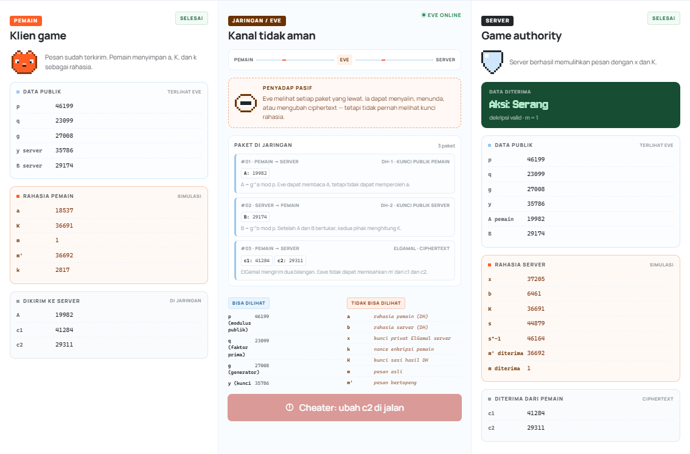

Gambar di atas memperlihatkan panel pemain, jaringan/Eve, dan server setelah dekripsi. Data publik ditandai biru, data rahasia ditandai oranye, dan ciphertext ditampilkan di panel jaringan.

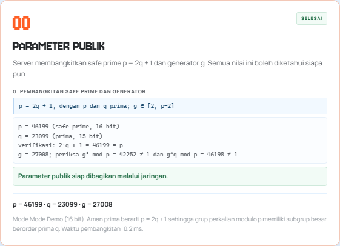

Tahap 0 menampilkan safe prime p, q, dan generator g beserta pemeriksaan g^2 dan g^q.

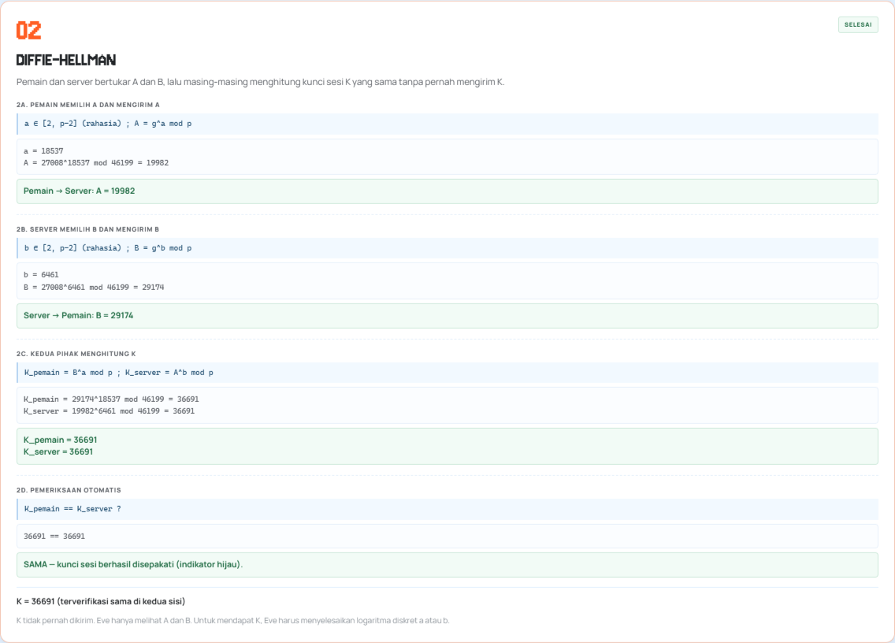

Tahap 2 menampilkan A, B, perhitungan K dari kedua sisi, dan indikator hijau bahwa K pemain = K server.

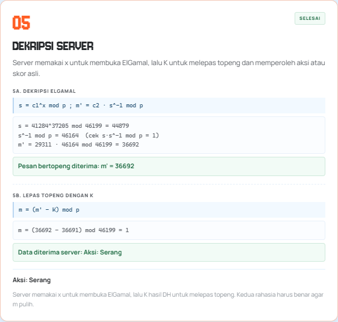

Tahap 5 menampilkan s, s^-1, pemulihan m', dan pelepasan topeng menjadi Aksi: Serang.

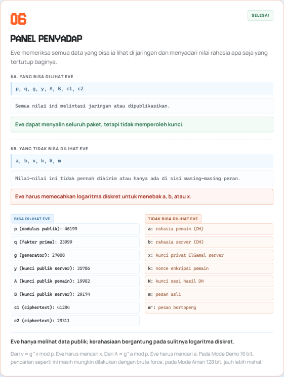

Panel Eve memisahkan data yang bisa dilihat (p, q, g, y, A, B, c1, c2) dari data rahasia yang tidak tersedia (a, b, x, k, K, m, m').

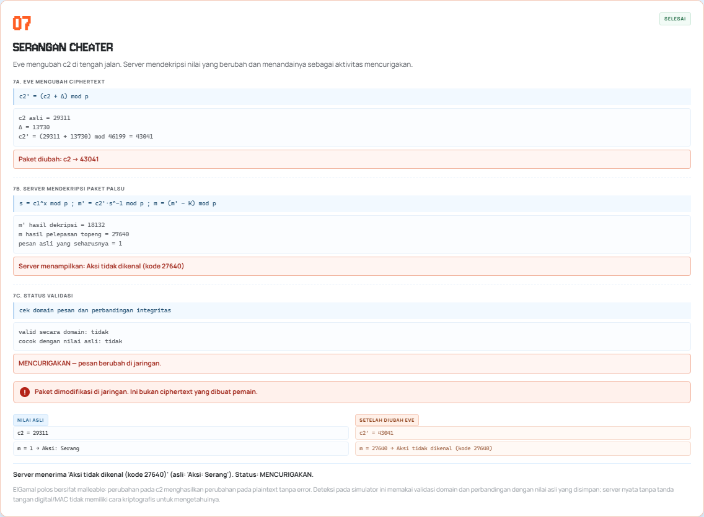

Tahap 7 memperlihatkan perubahan c2, hasil dekripsi yang ngawur, dan status MENCURIGAKAN. Catatan pada kartu menjelaskan bahwa deteksi ini berasal dari validasi domain dan perbandingan dengan nilai asli, bukan dari tag integritas ElGamal.

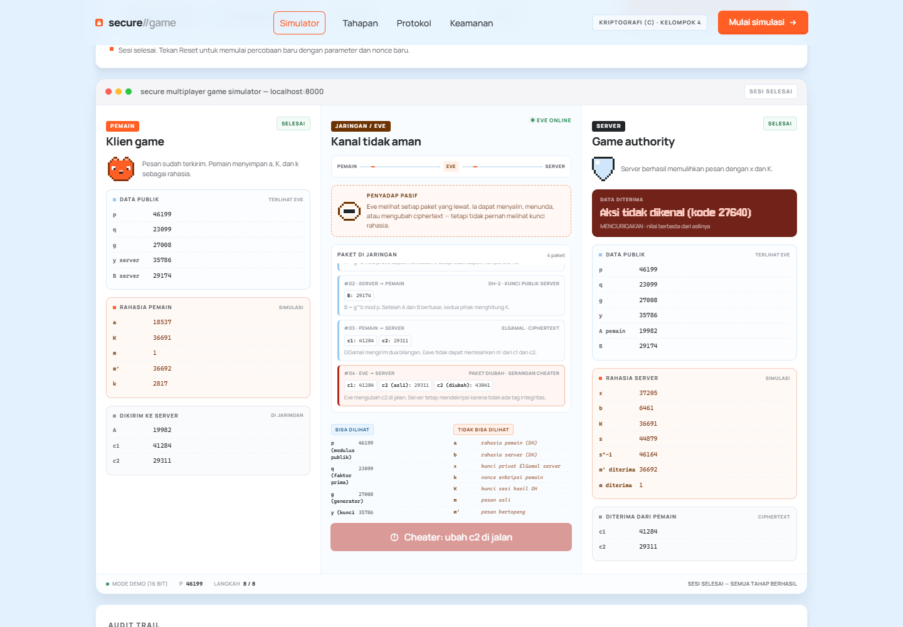

Konsol memperlihatkan empat paket yang tercatat, termasuk paket yang diubah Eve, serta hasil akhir di panel server.

## 5.4 Mode Aman 128 Bit

Mode Aman membangkitkan safe prime sekitar 128 bit. Nilai p pada sesi pengujian memiliki 39 digit. Server memakai fungsi yang sama; yang berubah hanya ukuran parameter. Frontend menampilkan nilai panjang sebagai string dan tidak mengonversinya ke Number.

Mode ini menunjukkan bahwa algoritma tidak bergantung pada panjang angka. Namun, 128 bit tetap tidak layak untuk produksi karena keamanan logaritma diskret generik hanya sekitar setengah panjang modulus (sekitar 64 bit), jauh di bawah rekomendasi modern.

## 5.5 Verifikasi Referensi p=23

Selain sesi live yang memakai safe prime 16 bit, proyek menyediakan
verifikasi terpisah untuk parameter contoh pada spesifikasi: p=23, g=5,
a=6, b=15, x=6, m=12, dan k=3. Verifikasi dijalankan oleh
`source_code/reference_demo.py` menggunakan modul kriptografi proyek yang
sama, bukan angka yang ditulis manual di laporan.

| Tahap | Substitusi | Hasil |
|---|---|---|
| Kunci publik DH Alice | A = 5^6 mod 23 | 8 |
| Kunci publik DH Bob | B = 5^15 mod 23 | 19 |
| Rahasia Alice | K_A = 19^6 mod 23 | 2 |
| Rahasia Bob | K_B = 8^15 mod 23 | 2 |
| Kunci publik ElGamal | y = 5^6 mod 23 | 8 |
| Ciphertext pertama | c1 = 5^3 mod 23 | 10 |
| Faktor y^k | 8^3 mod 23 | 6 |
| Ciphertext kedua (ElGamal murni) | c2 = 12 · 6 mod 23 | 3 |
| Shared secret dekripsi | s = 10^6 mod 23 | 6 |
| Invers modular | 6^-1 mod 23 | 4 |
| Pesan hasil dekripsi | m = 3 · 4 mod 23 | 12 |

Nilai-nilai tersebut sama dengan perhitungan manual pada
`docs/Perhitungan_Manual.md` dan diperiksa dengan `assert` di dalam skrip.
Aplikasi live memakai varian integrasi m' = (m + K) mod p. Untuk K=2 dan
m=12, varian itu menghasilkan m'=14, c2=15, lalu m'=14 saat dekripsi dan
m=12 setelah pelepasan topeng. Perbedaan c2=3 (ElGamal murni) dan c2=15
(varian integrasi) dijelaskan agar tidak dianggap kontradiktif.

## 5.6 Arena Pertarungan p=23: dari Aksi ke HP

Arena adalah studi kasus pertarungan yang memakai ElGamal murni dengan kunci
server p=23, g=5, x=6, y=8. Berbeda dari laboratorium tahapan yang memakai
topeng m' = (m + K) mod p, arena tidak memakai K sebagai kunci ElGamal.
Kunci DH hanya ditampilkan sebagai demonstrasi terpisah. Dengan demikian,
nilai c2 pada arena dapat dibandingkan langsung dengan contoh ElGamal murni.

Untuk mode deterministik k=3, c1 selalu 10 dan c2 bergantung pada kode aksi:

| Aksi | m | c1 | c2 = m·8^3 mod 23 | Damage server | HP monster | HP pemain |
|---|---:|---:|---:|---:|---:|---:|
| Serang | 1 | 10 | 6 | 25 | 100 → 75 | 100 → 90 |
| Gunakan Skill | 2 | 10 | 12 | 30 | 100 → 70 | 100 → 94 |
| Bertahan | 3 | 10 | 18 | 0 | 100 → 100 | 100 (tidak berubah) |

Nilai c2 tersebut bukan nilai yang dikirim client sebagai damage. Client
hanya mengirim pasangan (c1, c2). Server mendekripsi m, memeriksa bahwa m
berada pada 1..3, lalu mengambil damage dari tabel server. Jika client
mengirim field `damage: 999`, server tetap memakai damage 25 untuk aksi
Serang. Pengujian browser menunjukkan HP monster tetap 75/100 dan log
mencatat bahwa klaim 999 diabaikan.

Contoh lengkap aksi Serang:

```text
Plaintext      : m = 1 (Serang)
Mode           : deterministik k = 3
c1             : 5^3 mod 23 = 10
y^k mod p      : 8^3 mod 23 = 6
c2             : 1 · 6 mod 23 = 6
Ciphertext     : C = (10, 6)
Dekripsi s     : 10^6 mod 23 = 6
s^-1 mod 23    : 4
m hasil        : 6 · 4 mod 23 = 1
Damage server  : 25
HP monster     : 100 - 25 = 75
Serangan balik : 10
HP pemain      : 100 - 10 = 90
```

Jika ciphertext diubah menjadi c1=0, dekripsi ditolak karena c1 harus
berada pada 1..p-1. HP monster tidak berubah, transaksi berstatus
`rejected`, dan panel validasi menampilkan pesan penolakan. Ini
menunjukkan validasi input, bukan jaminan integritas kriptografis: ElGamal
polos tetap malleable jika perubahan kebetulan menghasilkan kode aksi yang
masih valid.

Tampilan arena dan demonstrasi manual p=23:

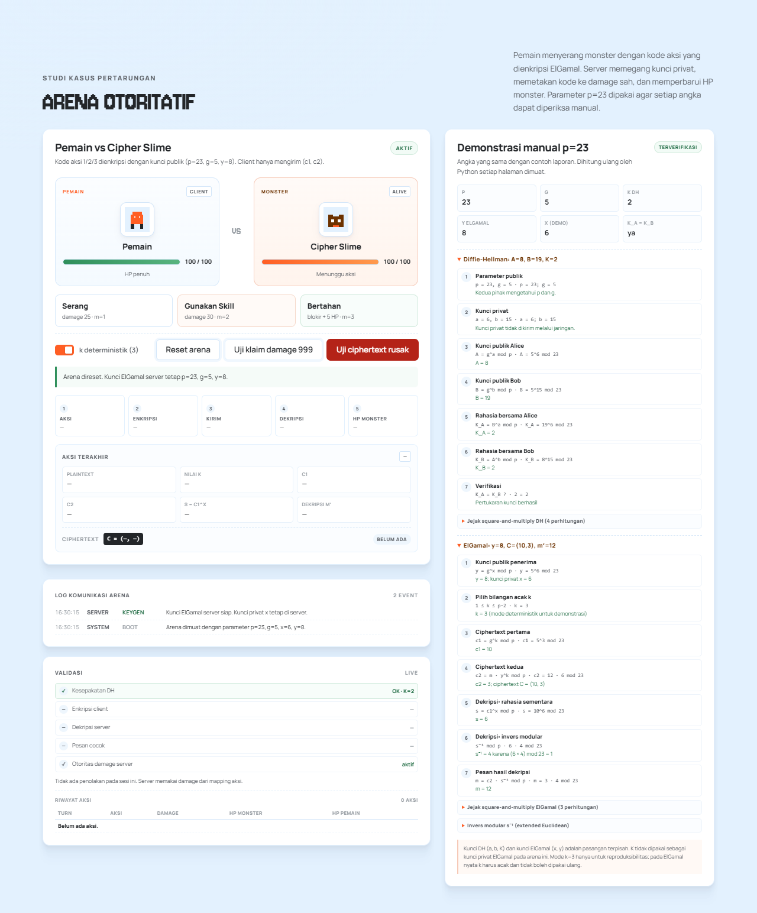

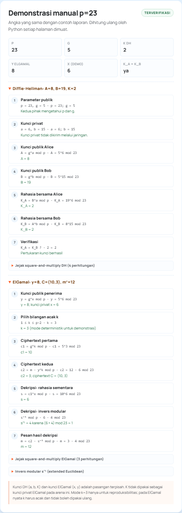

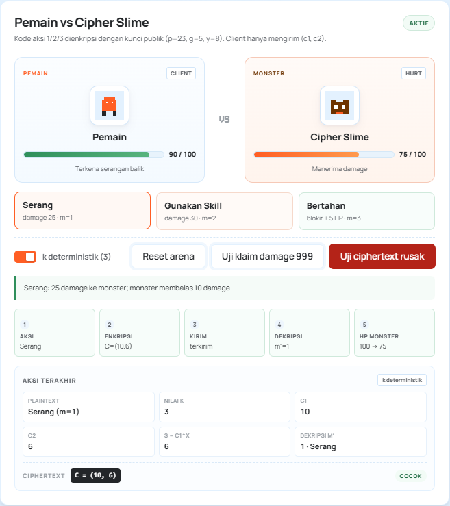

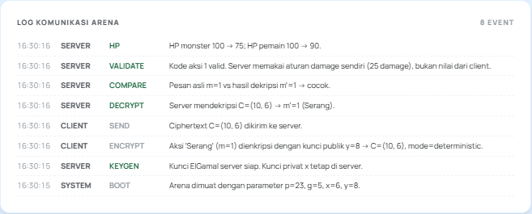

## 5.7 Analisis Keamanan

### 5.7.1 Apa yang Dilihat Eve

Eve dapat melihat:

- parameter publik p, q, g;
- kunci publik server y;
- nilai publik DH A dan B;
- ciphertext c1 dan c2;
- ciphertext yang telah diubah, c2'.

Eve tidak dapat melihat:

- eksponen rahasia pemain a;
- eksponen rahasia server b;
- kunci privat ElGamal x;
- nonce k;
- kunci sesi K;
- pesan asli m dan pesan bertopeng m'.

Untuk memperoleh a dari A = g^a mod p, Eve harus menyelesaikan logaritma diskret. Untuk memperoleh x dari y = g^x mod p, ia menghadapi masalah yang sama. Untuk memperoleh m dari ciphertext tanpa x dan K, ia harus memecahkan ElGamal dan logaritma diskret sekaligus.

### 5.7.2 Ukuran Parameter

Pada Mode Demo, p = 46199. Ruang nilai a dan x hanya sekitar 46000, sehingga brute force sangat mungkin. Program tidak menyembunyikan fakta ini; mode demo memang untuk verifikasi manual.

Pada Mode Aman, p memiliki 128 bit. Secara umum, keamanan DH/ElGamal dengan modulus n bit kira-kira setara dengan n/2 bit keamanan simetris terhadap algoritma diskret generik. Jadi modulus 128 bit hanya memberi sekitar 64 bit keamanan, belum memadai untuk data nyata. Rekomendasi produksi saat ini jauh lebih besar, misalnya DH 2048 bit atau lebih, atau kurva eliptik dengan ukuran keamanan yang setara.

### 5.7.3 Integritas dan Malleability

ElGamal polos tidak menjamin integritas. Perubahan pada c2 menghasilkan perubahan pada plaintext tanpa error. Simulator menandai serangan dengan dua cara:

1. Validasi domain: kode aksi harus 1, 2, atau 3. Jika hasil dekripsi berada di luar domain, server menandainya tidak valid.
2. Perbandingan dengan nilai asli yang disimpan simulator.

Cara kedua hanya mungkin karena simulator mengetahui pesan asli. Server nyata tanpa MAC, tanda tangan digital, atau AEAD tidak memiliki cara kriptografis untuk mengetahui bahwa ciphertext telah diubah. Jika perubahan kebetulan menghasilkan nilai yang masih berada di domain yang sah, server dapat menerimanya sebagai pesan valid. Inilah keterbatasan mendasar ElGamal polos.

### 5.7.4 Ancaman Man-in-the-Middle pada DH

DH polos tidak mengautentikasi A dan B. Penyerang aktif dapat:

1. mencegat A dari pemain;
2. mengirim A' miliknya sendiri ke server;
3. mencegat B dari server;
4. mengirim B' miliknya sendiri ke pemain;
5. membangun dua kunci sesi berbeda dan meneruskan pesan.

Program ini tidak memodelkan MITM secara penuh, tetapi analisis ini penting. Perbaikan memerlukan autentikasi kunci, misalnya tanda tangan digital atas A dan B, sertifikat, atau protokol terautentikasi seperti TLS.

### 5.7.5 Risiko Implementasi

Beberapa risiko implementasi yang perlu disadari:

- Kode Python buatan sendiri tidak constant-time. Waktu eksekusi dapat bocor melalui side channel pada lingkungan nyata.
- os.urandom dipakai untuk eksponen dan nonce; ini baik pada sistem operasi modern, tetapi kualitasnya bergantung pada sistem.
- State disimpan di memori dan tidak memiliki autentikasi pengguna. Siapa pun yang dapat memanggil API dapat membaca state simulasi.
- Simulator menampilkan rahasia di panel server/pemain untuk tujuan pendidikan. Pada sistem nyata, rahasia tidak boleh dikirim ke browser.
- Tidak ada perlindungan replay. Ciphertext yang sama dapat dikirim ulang.
- Tidak ada TLS pada server demonstrasi. Aplikasi berjalan di localhost untuk pembelajaran.
- Pesan hanya berupa bilangan. Untuk teks bebas, perlu encoding dan padding yang aman.

### 5.7.6 Saran Perbaikan

Untuk penggunaan nyata, rancangan ini perlu ditingkatkan:

1. Tambahkan integritas dengan HMAC, tanda tangan digital, atau AEAD. Ciphertext harus diautentikasi bersama konteks sesi.
2. Autentikasi pertukaran DH dengan sertifikat atau tanda tangan digital untuk mencegah MITM.
3. Gunakan protokol mapan seperti TLS 1.3 alih-alih implementasi kripto buatan sendiri.
4. Gunakan parameter produksi: DH 2048 bit atau lebih, atau ECDH/ElGamal pada kurva yang aman.
5. Terapkan perlindungan replay dengan nonce, timestamp, atau sequence number.
6. Gunakan pustaka kriptografi yang diaudit dan constant-time untuk produksi.
7. Pisahkan rahasia server dari browser. Simulator saat ini sengaja menampilkan rahasia untuk pembelajaran.
8. Tambahkan rate limiting, autentikasi pemain, dan audit log di sisi server.

# BAB VI — PENGUJIAN

## 6.1 Metode Pengujian

Pengujian dilakukan pada tiga lapisan:

1. **Unit test** dengan `unittest` untuk fungsi matematika, Diffie-Hellman, ElGamal, penyamaran pesan, dan aturan arena.
2. **Integration test HTTP** dengan `ThreadingHTTPServer` pada port acak untuk memeriksa endpoint, status code, JSON, dan perubahan state.
3. **Pengujian antarmuka** dengan browser headless (Playwright/Patchright) untuk memastikan tombol benar-benar memanggil endpoint dan angka yang tampil berubah sesuai state server.

Perintah pengujian:

```text
cd source_code
python -m unittest discover -s tests -v
python reference_demo.py
```

## 6.2 Daftar Kasus Uji

| ID | Kasus uji | Input | Hasil yang diharapkan | Hasil aktual | Status |
|---|---|---|---|---|---|
| T-01 | mod_exp dibandingkan pow | 80 kombinasi acak | Sama dengan pow(a,b,m) | Sama | Lulus |
| T-02 | Invers modular | 6 mod 23 | 4 | 4 | Lulus |
| T-03 | Invers non-koprima | 6 mod 9 | Ditolak | ModularError | Lulus |
| T-04 | DH p=23 | a=6, b=15 | A=8, B=19, K=2 | A=8, B=19, K=2 | Lulus |
| T-05 | DH 100 percobaan | safe prime 16 bit | K pemain = K server | Selalu sama | Lulus |
| T-06 | ElGamal p=23 | m=12, k=3 | c1=10, c2=3, s=6, s⁻¹=4, m′=12 | Sesuai | Lulus |
| T-07 | ElGamal 100 pesan | Mode Demo dan Aman | m pulih | Semua pulih | Lulus |
| T-08 | Pesan di luar rentang | m=0, m=23, m=-1 | Ditolak | Ditolak | Lulus |
| T-09 | k tidak valid | k=0, k=22 | Ditolak | Ditolak | Lulus |
| T-10 | Arena Serang | m=1, k=3 | C=(10,6), HP 75/90 | C=(10,6), HP 75/90 | Lulus |
| T-11 | Arena Skill | m=2, k=3 | C=(10,12), HP 70/94 | C=(10,12), HP 70/94 | Lulus |
| T-12 | Arena Bertahan | m=3, HP awal 50 | Damage 0, HP 55 | Damage 0, HP 55 | Lulus |
| T-13 | HP tidak negatif | Monster HP 10, Skill | HP 0, victory | HP 0, victory | Lulus |
| T-14 | Klaim damage 999 | ciphertext Serang | Damage tetap 25 | 25, klaim diabaikan | Lulus |
| T-15 | Ciphertext rusak | c1=0 | HTTP 400, HP tidak berubah | 400, HP 100 | Lulus |
| T-16 | Endpoint arena | GET state, POST encrypt/submit/reset | JSON valid dan state berubah | Sesuai | Lulus |
| T-17 | Halaman utama | GET / | Memuat Arena, DH, ElGamal, Kelompok 4 | Semua ada | Lulus |
| T-18 | UI end-to-end | Klik Serang, Skill, Bertahan | HP berubah dan log bertambah | 75/90, 45/84, 89/100 | Lulus |
| T-19 | UI klaim damage | Klik Uji klaim 999 | HP 75, damage 25 | Sesuai | Lulus |
| T-20 | UI ciphertext rusak | Klik Uji ciphertext rusak | Ditolak, HP tetap | Sesuai | Lulus |
| T-21 | Simulator tahapan | Jalankan Semua | 8/8 tahap | 8/8 tahap | Lulus |
| T-22 | Referensi p=23 | reference_demo.py | Semua assert lulus | Semua assert lulus | Lulus |

## 6.3 Hasil Eksekusi Otomatis

Keluaran aktual (ringkas) dari lingkungan pengembangan Python 3.13.7:

```text
$ python -m unittest discover -s tests -v
...
Ran 46 tests in 0.732s

OK
```

Rincian kelompok pengujian:

| Kelompok | Jumlah | Status |
|---|---:|---|
| MathUtilityTests | 11 | Lulus |
| DiffieHellmanTests | 3 | Lulus |
| ElGamalTests | 6 | Lulus |
| TextbookTests | 5 | Lulus |
| ArenaTests | 10 | Lulus |
| ApiTests | 9 | Lulus |
| **Total** | **46** | **Lulus** |

Verifikasi referensi p=23 dijalankan dengan `python reference_demo.py` dan
menghasilkan A=8, B=19, K=2, y=8, c1=10, c2=3, s=6, s⁻¹=4, m′=12. Seluruh
assert pada skrip tersebut lulus. Keluaran lengkap disimpan pada
`docs/Hasil_Pengujian.txt`.

## 6.4 Pengujian Antarmuka

Pengujian browser dilakukan pada halaman yang benar-benar berjalan di
`http://127.0.0.1:8000`. Hasil yang diamati:

| Skenario | Hasil aktual |
|---|---|
| Halaman dibuka | Judul dan panel Arena, Simulator, Tahapan tampil |
| Serang (k=3) | C=(10,6), m′=1, HP monster 100→75, HP pemain 100→90 |
| Skill (k=3) | C=(10,12), m′=2, HP monster 75→45, HP pemain 90→84 |
| Bertahan | Damage 0, HP pemain 84→89, HP monster tetap 45 |
| Reset arena | HP 100/100, turn 0 |
| Uji klaim damage 999 | Damage 25, HP monster 75, klaim dicatat dan diabaikan |
| Uji ciphertext rusak | HTTP 400, HP monster tetap 75, validasi DITOLAK |
| Jalankan Semua tahapan | Progres 8/8, 8 kartu tahap, log 11 entri |

Tidak ada error JavaScript yang tidak diharapkan. Satu-satunya respons 400
pada pengujian adalah respons yang memang diharapkan dari tombol
"Uji ciphertext rusak".

## 6.5 Ringkasan

Seluruh 46 test otomatis lulus. Pengujian HTTP menunjukkan endpoint
mengembalikan status dan JSON yang sesuai, sedangkan pengujian browser
menunjukkan tombol dan panel benar-benar bekerja. Hasil ini berlaku untuk
lingkungan pengembangan yang dicatat pada Bab 4; pengujian tidak mengklaim
keamanan produksi.

# BAB VII — KESIMPULAN DAN SARAN

## 7.1 Kesimpulan

Program Secure Multiplayer Game Simulator berhasil mengimplementasikan Diffie-Hellman dan ElGamal dari nol dan menampilkan seluruh tahap 0–7 dengan angka nyata. Pemain dan server menyepakati K tanpa mengirim K; pesan disamarkan menjadi m' = (m + K) mod p; ElGamal mengenkripsi m'; server mendekripsi dengan x lalu melepas topeng dengan K. Pemeriksaan otomatis menunjukkan K pemain = K server, dan hasil dekripsi mengembalikan aksi atau skor yang benar.

Arena pertarungan melengkapi studi kasus dengan parameter p=23: ElGamal murni mengenkripsi kode aksi 1/2/3, server memegang x=6, dan aturan damage 25/30/0 diterapkan di server. Pengujian browser menunjukkan HP monster berubah dari 100 menjadi 75 setelah Serang, 75 menjadi 45 setelah Skill, dan tetap 45 setelah Bertahan; klaim damage 999 diabaikan. Nilai referensi p=23 (A=8, B=19, K=2, y=8, c1=10, c2=3, s=6, s⁻¹=4, m′=12) juga lulus di `reference_demo.py`.

Pengujian otomatis mencakup 46 test, termasuk 100 percobaan DH, 100 pesan pada masing-masing mode, invers modular, Miller-Rabin, safe prime, aturan arena, endpoint HTTP, dan skenario tamper. Seluruh test lulus. Aplikasi berjalan offline di http://localhost:8000 dengan backend Python standard library dan frontend HTML/CSS/JavaScript murni.

Dari sisi keamanan, program menunjukkan bahwa kerahasiaan saja tidak cukup. ElGamal polos bersifat malleable, DH polos rentan MITM, dan Mode Demo 16 bit mudah dipecahkan dengan brute force. Mode Aman 128 bit hanya untuk demonstrasi, bukan produksi. Perbaikan yang diperlukan meliputi autentikasi, integritas pesan, perlindungan replay, dan parameter yang jauh lebih besar.

## 7.2 Keterbatasan

1. Parameter p=23 dan safe prime 16 bit hanya untuk pembelajaran; keduanya tidak aman untuk data nyata.
2. Client dan server berjalan pada satu proses lokal. Pemisahan kunci bersifat konseptual; panel demonstrasi sengaja menampilkan kunci privat agar dapat diperiksa.
3. ElGamal polos tidak menyediakan integritas, autentikasi pengirim, atau perlindungan replay. Validasi kode aksi di server tidak menggantikan MAC atau tanda tangan digital.
4. Diffie-Hellman polos tidak mengautentikasi pihak yang bertukar kunci sehingga tetap rentan MITM.
5. Mode deterministik k=3 hanya untuk reproduksibilitas. Pada ElGamal nyata, k harus acak, rahasia, dan tidak boleh dipakai ulang.
6. Implementasi Python tidak constant-time dan tidak melalui audit keamanan.
7. Frontend menampilkan rahasia pada mode demo; ini tidak boleh dilakukan pada sistem produksi.
8. Aplikasi tidak memakai TLS, autentikasi pemain, rate limiting, atau penyimpanan state persisten.

## 7.3 Saran Pengembangan

1. Tambahkan integritas dan autentikasi dengan HMAC, tanda tangan digital, atau AEAD.
2. Autentikasi pertukaran DH dengan sertifikat atau tanda tangan digital untuk mencegah MITM.
3. Gunakan protokol mapan seperti TLS 1.3 untuk komunikasi nyata.
4. Gunakan parameter produksi (DH 2048 bit atau lebih, atau ECDH/ElGamal pada kurva yang aman) dan pustaka yang diaudit.
5. Tambahkan nonce, timestamp, atau sequence number untuk perlindungan replay.
6. Pisahkan kunci privat dari browser dan gunakan penyimpanan kunci yang aman.
7. Tambahkan autentikasi pemain, otorisasi, rate limiting, dan audit log.
8. Kembangkan pengujian properti dan pengujian beban untuk skenario banyak pemain.

# LAMPIRAN

## A.1 Daftar File

| File | Keterangan |
|---|---|
| source_code/mathutil.py | Aritmetika modular, primality, safe prime, generator, random, trace |
| source_code/diffie_hellman.py | Protokol DH dan verifikasi kunci |
| source_code/elgamal.py | Key generation, enkripsi, dekripsi, mask, tamper |
| source_code/game_engine.py | Arena, aturan damage, HP, demonstrasi p=23 |
| source_code/server.py | HTTP server, API, state sesi, state arena, file statis |
| source_code/static/index.html | Halaman antarmuka, termasuk Arena dan panel p=23 |
| source_code/static/css/style.css | Tema Obscura, layout, komponen, gaya Arena |
| source_code/static/js/app.js | Kontrol tahap, fetch API, rendering laboratorium |
| source_code/static/js/arena.js | Kontrol Arena, HP, log, dan demonstrasi p=23 |
| source_code/static/js/pixels.js | Sprite piksel lokal |
| source_code/tests/test_crypto.py | Pengujian matematika, DH, ElGamal |
| source_code/tests/test_arena.py | Pengujian aturan Arena dan endpoint HTTP |
| source_code/reference_demo.py | Verifikasi parameter referensi p=23 |
| docs/Perhitungan_Manual.md | Perhitungan manual p=23 dan varian integrasi |
| docs/Hasil_Pengujian.txt | Keluaran aktual unittest dan reference_demo.py |
| docs/build_report.py | Pembangun DOCX dari Markdown |
| docs/build_pdf.py | Pembangun PDF dari Markdown (opsional) |
| README.md / README.txt | Cara menjalankan program |
| requirements.txt | Catatan dependensi (standard library) |
| .gitignore | Berkas yang tidak perlu dikirim |
| Laporan_Kelompok_4.md | Laporan versi Markdown |
| Laporan_Kelompok_4.docx | Laporan versi Word |
| Laporan_Kelompok_4.pdf | Laporan versi PDF |

## A.2 Cara Menjalankan

```text
cd source_code
python server.py
```

Buka http://localhost:8000 di browser. Tidak perlu memasang dependensi apa pun.

Untuk port lain:

```text
python server.py --port 8080
```

## A.3 Cara Menjalankan Test

```text
cd source_code
python -m unittest discover -s tests -v
```

## A.4 Daftar Screenshot

| File | Isi |
|---|---|
| docs/screenshots/00-halaman-penuh.png | Halaman awal |
| docs/screenshots/03-tahap-0.png | Tahap 0 parameter publik |
| docs/screenshots/04-diffie-hellman.png | Tahap 2 DH lengkap |
| docs/screenshots/05-enkripsi-elgamal.png | Tahap 4 enkripsi |
| docs/screenshots/06-dekripsi-server.png | Tahap 5 dekripsi |
| docs/screenshots/07-panel-eve.png | Tahap 6 panel Eve |
| docs/screenshots/08-serangan-cheater.png | Tahap 7 serangan |
| docs/screenshots/12-tiga-panel.png | Tiga panel peran |
| docs/screenshots/13-konsol-setelah-serangan.png | Konsol setelah serangan |
| docs/screenshots/10-mode-aman.png | Mode Aman 128 bit |
| docs/screenshots/11-mobile.png | Tampilan responsif |
| docs/screenshots/15-arena-awal.png | Arena awal dengan HP 100/100 |
| docs/screenshots/16-demo-p23.png | Demonstrasi manual p=23 |
| docs/screenshots/17-arena-setelah-serangan.png | Arena setelah Serang |
| docs/screenshots/18-arena-log.png | Log komunikasi Arena |
| docs/screenshots/19-halaman-penuh-arena.png | Halaman penuh dengan Arena |

## A.5 Pernyataan Kepatuhan

- Tidak ada import cryptography, pycryptodome, sympy, gmpy2, hashlib, secrets, ssl, Flask, Django, FastAPI, atau framework web lain pada kode utama.
- Tidak ada pemanggilan pow(a, b, m) tiga argumen pada kode utama. Pemanggilan pow hanya ada di tests/test_crypto.py sebagai pembanding independen.
- Tidak ada CDN atau pustaka JavaScript eksternal. Font disimpan di source_code/static/fonts.
- Frontend tidak melakukan perhitungan kripto; semua nilai kripto dikirim sebagai string.

# Daftar Pustaka

1. W. Diffie and M. E. Hellman, "New Directions in Cryptography," IEEE Transactions on Information Theory, vol. 22, no. 6, pp. 644–654, 1976. DOI: 10.1109/TIT.1976.1055638.
2. T. ElGamal, "A Public Key Cryptosystem and a Signature Scheme Based on Discrete Logarithms," IEEE Transactions on Information Theory, vol. 31, no. 4, pp. 469–472, 1985. DOI: 10.1109/TIT.1985.1057074.
3. W. Stallings, Cryptography and Network Security: Principles and Practice, 8th ed., Pearson, 2020.
4. D. Boneh and V. Shoup, A Graduate Course in Applied Cryptography, versi daring, 2023. https://crypto.stanford.edu/~dabo/cryptobook/ (diakses 27 Oktober 2026).
5. C. Paar and J. Pelzl, Understanding Cryptography: A Textbook for Students and Practitioners, Springer, 2010. DOI: 10.1007/978-3-642-04101-3.
6. NIST, FIPS 186-5: Digital Signature Standard (DSS), 2023. https://doi.org/10.6028/NIST.FIPS.186-5.
7. E. Rescorla, "RFC 7919: Negotiated Finite Field Diffie-Hellman Ephemeral Parameters for Transport Layer Security (TLS)," IETF, 2016. DOI: 10.17487/RFC7919.
8. Python Software Foundation, "http.server — HTTP servers," Python 3 Documentation. https://docs.python.org/3/library/http.server.html (diakses 27 Oktober 2026).
9. Python Software Foundation, "unittest — Unit testing framework," Python 3 Documentation. https://docs.python.org/3/library/unittest.html (diakses 27 Oktober 2026).
